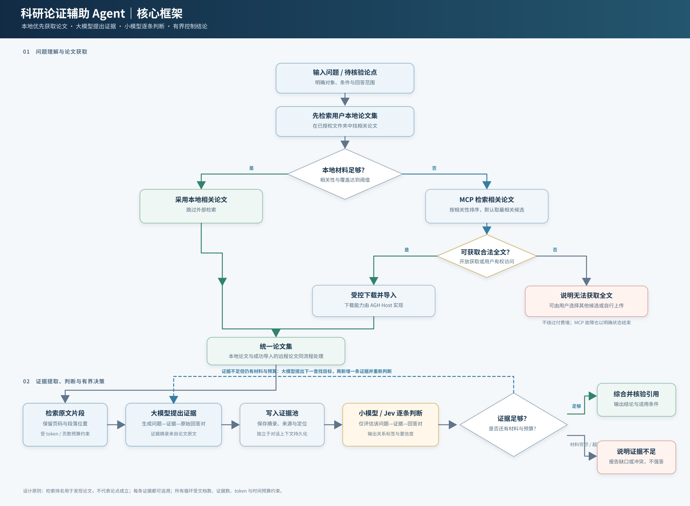

# Agnes Harness 科研论证辅助 Agent：V1 设计报告

> **用途**：交给代码 AI 作为二次开发需求与架构约束，也作为团队实现和比赛验收的共同基线。  
> **版本**：V1 方案草案  
> **目标**：在 AGH 上构建一个本地论文优先、MCP 文献检索回退的科研辅助 Agent：先查用户论文集；本地没有足够相关材料时调用 Athenaeum MCP，尝试将最相关且可合法获取全文的一篇下载到用户指定的本地论文集；随后由大模型提取原文证据、小模型逐条评估，并输出可追溯结论。



## 1. 项目目标

本项目不是通用聊天机器人，也不以自动撰写长篇综述作为首要目标。V1 聚焦以下科研工作：

1. 研究者提出问题或待核验论点。
2. Agent 先在用户选择的本地论文集/文件夹中检索相关材料。
3. 本地未找到足够相关论文时，调用 Athenaeum MCP 按问题检索；默认选择排名最相关的一篇，检查开放全文来源并尝试下载到用户指定的本地论文集。
4. 下载成功的论文进入与本地论文相同的识别、解析、索引和证据提取流程。付费墙、无全文、下载失败或格式不支持时不得绕过访问控制，必须说明原因。
5. 大模型为每条候选证据生成结构化的“问题—证据—原始回答”评估对。
6. 小模型/Jev 只评估该评估对，判断证据与回答的关系并输出置信度；它不读取整篇论文，也不负责找下一条证据。
7. 大模型根据评估结果继续查找、停止并综合，或在证据穷尽后说明无法回答。
8. 最终回答逐项引用论文文件、页码、段落及原文摘录；不能核验的位置必须明确标示。

项目的核心技术主张是：**在有限上下文和推理预算下，以逐条证据判断和有边界的迭代检索，提升长论文问题回答的证据支持质量、引用可追溯性和不确定性处理能力。**

## 2. 用户需求与系统边界

### 2.1 输入

- 一个研究问题、事实问题、方法有效性问题或待核验论点。
- 一个或多个用户选择的论文文件/文件夹。
- 自动回退检索：本地无足够相关材料时调用 Athenaeum MCP，获取候选元数据并尝试导入一篇可访问全文。

### 2.2 输出

- 有证据支持的回答，或明确的“当前材料不足以判断”。
- 对每项关键回答，显示支持/反驳/条件性支持/证据不足/证据冲突等关系。
- 原文摘录、文件名或文献身份、页码、段落/章节定位。
- 已检查材料范围、未读/失败文件、证据缺口和结论适用条件。

### 2.3 非目标

- V1 不承诺自动访问付费墙论文或绕过版权与数据库访问限制。
- V1 不把模型生成的引用当作已验证引用。
- V1 不自动生成统计学荟萃分析，不复现实验，也不替代领域专家判断。
- V1 不默认支持所有文档格式；未支持格式必须显式报告。
- MCP 是本地检索失败后的回退路径；MCP 不可用时，本地论文分析仍可独立运行。
- V1 默认只尝试导入一篇最相关候选论文，避免无界下载与上下文膨胀。
- 只下载明确开放获取或用户有权访问的论文；不绕过付费墙、反爬或站点访问限制。

## 3. 当前 AGH 基线与实现约束

编码前须对照当前分支复核这些现状，不要假设功能已经覆盖本需求：

- AGH 已有 Core 会话执行状态机、事件记录和上下文压缩机制。应先定位卡死链路，不要另造一套通用会话压缩。
- 仓库内置 `@agnes/document-reader` 目前通过 `session-file://` 读取当前会话附件，不接受任意磁盘路径；PDF 按页读取，支持文本提取/OCR，另支持 DOC/DOCX、ZIP 选定条目及文本。存在输入大小、页数、输出、工作线程数量与超时限制。
- 因此，文件夹功能需要新增受授权的批量导入/文件清单能力；不能简单把绝对路径交给插件，也不能把整个文件夹内容塞进提示词。
- 文档读取器是受信任的进程内插件。新增能力应保持受控路径、文件类型识别、资源上限、取消和清理。
- 项目架构文档指出 Jev 集成仍在进行中，当前主执行循环为内置 Core loop。若 Jev 不能在目标分支可用，使用 `EvidenceJudge` 接口并实现一个可替换的评估器适配器；不得在 UI/README 中宣称 Jev 已工作，除非端到端验证通过。
- 应遵守包 `exports` 与模块边界。不要从其他包深度导入私有 `src`，不要让浏览器模块获得 Host/Node/daemon 管理能力。

相关源码入口：

- [架构指南](../docs/develop/architecture.md)
- [源码地图](../docs/develop/source-map.md)
- [Document Reader 插件说明](../packages/package-manager/bundled-plugins/document-reader/README.md)
- [Document Reader 注册入口](../packages/package-manager/bundled-plugins/document-reader/index.mjs)
- [Core 会话状态机](../packages/core/src/step/session.ts)
- [Core 上下文压缩](../packages/core/src/step/compaction.ts)
- [Compaction 计划](../packages/base/extensions/compaction/src/plan.ts)
- [插件边界与生命周期](../docs/develop/plugins.md)

## 4. 目标架构

```mermaid
flowchart LR
    U[问题 / 论点 + 用户论文集] --> Q[大模型解析问题与范围]
    Q --> LOCAL[检索本地论文集]
    LOCAL --> HIT{本地有足够相关论文？}
    HIT -->|有| DOCS[本地相关论文]
    HIT -->|没有| MCP[调用 Athenaeum MCP 检索]
    MCP --> TOP[去重排序，选择最相关候选]
    TOP --> OA{开放全文可用？}
    OA -->|可用| DL[受控下载到指定本地论文集]
    OA -->|无全文 / 下载失败| NOFILE[说明原因，请用户选择或上传]
    DL --> DOCS
    DOCS --> INGEST[统一类型识别、解析、索引]
    INGEST --> LLM[大模型读取相关原文并提取证据]
    LLM --> PAIR[生成问题—证据—原始回答对]
    PAIR --> POOL[证据池持久化]
    POOL --> JEV[小模型 / Jev 逐条评估]
    JEV --> CTRL{大模型控制器判断}
    CTRL -->|证据足够| ANSWER[综合回答并核验引用]
    CTRL -->|仍不足且有材料/预算| LLM
    CTRL -->|材料穷尽 / 预算耗尽| INSUFF[报告缺口、冲突或无法判断]
    ANSWER --> OUT[结论 + 摘录 + 文件 / 页码 / 段落]
    INSUFF --> OUT
    NOFILE --> OUT
```



### 4.1 职责划分

| 组件 | 职责 | 不负责 |
|---|---|---|
| Web 客户端 | 选择/上传目录内容、显示导入与研究进度、文件状态、取消任务、呈现可点击引用 | 直接遍历任意本机路径、持有 Node/daemon 管理凭据、判断证据真伪 |
| 本地论文检索器 | 在用户授权的文档集内找相关论文/片段，返回相关度和命中依据 | 把未命中解释为整个学术领域不存在相关研究 |
| Athenaeum 检索适配器 | 调用 `athenaeum_search` 获取候选元数据、去重排序；查开放 PDF 候选 | 将元数据排名当成证据质量或结论可信度 |
| 受控下载/导入服务 | 从获准来源下载候选 PDF 到用户指定文档集，校验 URL、签名、大小、哈希和来源 | 接受模型任意目的路径、绕过网络安全策略、静默覆盖文件 |
| 文档导入服务 | 在用户授权范围内枚举文件、识别类型、校验、排队、调用解析器、生成文档清单 | 自行决定论文结论、绕过工作区策略 |
| 文档解析器 | 提取文本/页码/章节/段落，扫描页可用 OCR；报告不确定性 | 把 OCR 或版面重建结果伪装成完美原文 |
| 大模型 | 理解问题、确定检索目标、阅读相关原文、产生证据对、根据评估决定下一步、综合最终回答 | 自行把自己的回答标成已验证 |
| EvidenceJudge / Jev | 对单条问题—证据—原始回答对做独立评估，返回结构化标签和置信度 | 阅读整篇文档、检索下一证据、改写最终答案 |
| 证据仓/任务状态 | 持久化文档标识、证据、判断、预算、进度及引用位置 | 依赖聊天历史作为唯一事实来源 |
| AGH Core / Host | 继续负责现有模型调用、工具生命周期、会话状态、取消、事件和授权边界 | 承载特定科研领域的硬编码业务逻辑，除非现有扩展接口确实不足 |

## 5. 科研任务状态机与控制策略

### 5.1 建议状态

`created → question_parsed → local_search → (local_hit | mcp_search) → (candidate_selected → fulltext_check → downloading → importing | acquisition_unavailable) → indexing → searching_evidence → judging_evidence → (searching_evidence | synthesizing | insufficient | failed | cancelled) → citation_check → completed`

每个转换应有事件记录、输入/输出摘要、时间、文档集版本与预算快照。用户取消、进程中断或模型错误后，状态应能被检查；若安全恢复条件满足，可从最后一个完整证据检查点继续。

### 5.2 核心循环

1. 大模型把用户输入解析为目标主张、对象、条件/范围、需要回答的问题和当前已知限制。
2. 本地检索器先查用户选择的论文集。若本地命中不足，才调用 Athenaeum MCP；用户也可显式要求外部扩展。
3. 若触发 MCP 回退，检索适配器以问题作为自然语言查询，去重并按相关性排序候选；默认选排名第一篇最相关论文，并记录查询、提供方、标题、DOI/URL、排名和摘要等元数据。
4. 对候选检查是否有可合法访问的全文。当前 Athenaeum MCP 能检索并读取部分开放 PDF，但未确认有将 PDF 文件写入 AGH 指定文档集的工具；因此需在 AGH Host 侧实现受控下载/导入，校验允许来源、重定向目标、内容类型、文件大小与哈希，并保留来源链接。不得接受模型提供的任意写入路径或绕过付费墙。
5. 下载成功的文件与用户本地论文走同一导入、解析、分段和索引链路；仅摘要可用或无法下载时，明确标注获取级别与原因，不将摘要伪装成全文证据。若第一候选不可用，V1 可按配置有限尝试后续候选，或提示用户选择/上传。
6. 对每个候选片段，大模型生成一条 `EvidenceAssessmentInput`，至少包含：问题、目标回答/主张、逐字证据摘录、必要上下文、来源位置、模型原始回答。
7. 证据写入持久化证据池，再由小模型/Jev 评估这一个证据对。评分不可脱离原文摘录与上下文。
8. 将评估结果附加到证据记录。大模型依据整个证据池、关系标签、覆盖情况与剩余预算选择下一步。
9. 若证据足以回答，停止搜索并做最终引用核验；若还有相关材料且预算未耗尽，制定下一条查找目标；若材料穷尽或达到预算边界，停止并解释证据不足。
10. 最终答案只能使用证据池中已核验或明确标记未核验的内容；不得凭空补出页码、原句或文献结论。

### 5.3 终止条件必须是有界的

必须设置并记录以下上限，具体数值通过配置决定：最大证据数、最大文档数、最大页/片段读取量、最大循环次数、最大任务时长、最大输入 token、最大单文档尺寸和最大总解析字节数。

正常终止条件：

- **可回答**：当前证据足以回答目标问题；结论关系和适用边界明确，且关键引用已定位。
- **材料穷尽**：相关文档/段落已遍历或检索器已无候选，仍不足以回答。
- **预算耗尽**：达到任一配置上限，输出当前能支持的有限结论与缺口。
- **冲突待解**：关键来源相互矛盾且无法在预算内解决，报告冲突，不强行平均或选边。

## 6. 数据结构建议

以下是逻辑 schema 草案，实际编码需使用项目当前导出类型与序列化约定：

```ts
type ResearchRun = {
  runId: string
  question: string
  normalizedClaims: Array<{ id: string; text: string; scope?: string }>
  state: ResearchState
  budget: { maxIterations: number; maxEvidence: number; maxInputTokens: number; deadlineAt: string }
  documentSetRevision: string
}

type DocumentRecord = {
  documentId: string       // 建议内容哈希，不用用户路径作身份
  displayName: string
  detectedFormat: string
  status: 'queued' | 'parsing' | 'indexed' | 'partial' | 'failed' | 'unsupported'
  pageCount?: number
  contentHash: string
  parserWarnings: string[]
}

type EvidenceRecord = {
  evidenceId: string
  claimId: string
  documentId: string
  location: { page?: number; paragraph?: number; section?: string; table?: string }
  quote: string              // 原文摘录，保留逐字文本
  context?: string           // 有界的相邻上下文
  question: string           // 交给评估器的问题
  proposedAnswer: string     // 大模型原始回答
  relation?: 'supports' | 'contradicts' | 'conditional' | 'insufficient' | 'unclear'
  confidence?: number
  judgeVersion?: string
  judgeExplanation?: string
  verification: 'unverified' | 'verified' | 'location_failed'
}
```

证据对象应有不可变来源定位与文档 revision。修订或重新 OCR 后不能静默沿用旧页码/段落判断。敏感路径不应进入模型 prompt、浏览器 `publicConfig` 或公开日志。

## 7. 本地优先检索与 MCP 远程回退

本地论文集是第一检索范围，MCP 是没有足够本地材料时的候选发现路径。判断“本地没有”应基于可配置的相关性阈值、命中数量和覆盖情况，并在任务记录中保存命中摘要；不能把一次检索零命中解释为学术领域不存在相关论文。用户可显式要求拓展外部来源。

Athenaeum 的 `athenaeum_search` 接受自由文本问题/主题并返回跨提供方候选，适合发现论文；它的排名、摘要或共识类结果不能直接作为论点已被证明的依据。检索适配器应记录查询和候选元数据，去重后默认选择第一篇最相关论文。若首篇没有合法全文，按小的可配置上限检查后续候选，超限则交由用户选择，避免自动下载大量材料。

**下载能力是 AGH 侧需要实现的能力，不应假设 MCP 已经把文件保存到本地。** 建议 Host 下载服务只接受 MCP 返回并通过策略检查的 PDF URL，限制协议/域名/重定向、超时、最大字节数和 MIME/文件签名；下载到用户明确选择的文档集临时区，校验成功后原子导入并计算哈希。记录 DOI、落地页、PDF URL、检索时间、提供方和许可证/开放获取状态（若可得）。下载失败、疑似付费墙、反爬、无 PDF 或无授权时停止该候选并告知用户，不绕过访问限制。

成功导入后，远程论文与本地论文统一进入解析和证据核验；远程检索只负责找候选，最终证据仍必须来自可定位的论文原文。MCP 超时、不可用或返回空结果时，保留本地分析路径并报告“外部检索未完成”。摘要级材料需显式标为 `abstract_only`，不得给出页码/段落级全文引用。

## 8. 文件夹导入与文件类型识别

### 8.1 导入设计

- Web 端提供用户显式选择文件夹/多文件的入口；或提供受 Host 工作区授权保护的服务端扫描。首版选择一种可跨目标浏览器验收的方式。
- 不接受 Agent 自由传入任意绝对路径；不跟随越界符号链接/junction；扫描边界绑定用户已选择的 workspace/document set。
- 先建立 manifest，再并发有限的解析队列；逐文件返回状态、大小、识别格式、页数、错误和进度。
- 使用内容哈希去重，展示同名但内容不同的文件；导入中可取消，失败可单文件重试。
- V1 建议支持 PDF、DOCX、TXT/Markdown；对 DOC、ZIP 可复用现有 reader 能力，但应确认文件夹流水线是否覆盖；XLSX/PPTX/图像先显示为暂不支持，不假装已理解。
- 扫描 PDF 使用现有 OCR；OCR 置信不足时标记 `partial` 或 `needs_review`，允许回看原页。

### 8.2 索引与上下文预算

- 解析结果保存在任务文档仓/受控 artifact，不追加整份全文到会话消息。
- 按论文结构切分为章节、段落或表格单元，切块保留页码和文档 revision；避免按固定 token 截断而切断结论与限制条件。
- 候选查找可采用全文检索/关键词与语义检索组合。V1 可先实现简单、可复现的检索，不必以复杂向量数据库作为亮点。
- 每次模型调用只带问题、命中片段、必要上下文、已选证据摘要及预算；支持 token 估算并为模型输出预留空间。
- Compaction 可以压缩对话历史，但不得丢弃证据仓中的原文、出处和评估记录。最终结论要能从持久证据记录重建。

## 9. 网页卡死与运行韧性

“上下文 token 用满”是目前观察到的原因/假设，尚需用 trace 验证具体阻塞点。实现前加可观测性：

- 每个任务显示阶段、当前文件/页、已完成/总数、最近心跳、模型请求状态、当前迭代/剩余预算。
- 记录请求 token 估算、压缩前后状态、文档解析耗时、模型调用耗时、工具输出字节数和失败码；日志避免包含全文或密钥。
- 后端长任务使用可查询的 `runId` 和事件进度，Web 轮询或订阅事件只更新进度，不阻塞主线程。
- PDF/OCR 和批处理不得在浏览器主线程同步执行；后端/worker 任务应保持有界并发，可取消并在结束时释放 worker/对象 URL/临时资源。
- 单文件超时或损坏只将该文件标为失败，其他文件可继续；整个任务预算到期时做可解释终止。
- 网络重试仅限明确可重试错误，次数/退避有上限；写入或计费型外部副作用不盲目重放。
- 用户取消后禁止继续创建模型调用；若请求结果未知，展示“结果未知/需要检查”，而不是重发造成重复操作。

## 10. 异常处理矩阵

| 故障 | 处理 | 终态/用户可见信息 |
|---|---|---|
| 不支持格式/伪造扩展名 | MIME + 文件签名识别，拒绝解析 | `unsupported`，说明格式 |
| PDF 损坏/加密/超大 | 文件级失败，不拖垮批次 | `failed`，可重试/移除 |
| 扫描件 OCR 无结果/低质量 | 保留 OCR 状态；允许查看原页，不把空文本当空白页 | `partial/needs_review` |
| 文件夹读取权限拒绝 | 不提升权限、不绕过策略 | 任务暂停或该目录失败，说明授权范围 |
| 本地论文检索无足够命中 | 转入 MCP 回退并记录原因；MCP 不可用则提示用户导入材料 | 显示本地未命中与外部检索状态 |
| MCP 超时/限流/无候选 | 有界重试仅用于可重试错误；保留本地结果，不阻塞任务 | `external_search_unavailable`，显示查询失败原因 |
| MCP 有候选但无合法全文 | 有界尝试后续候选或提示用户选择/上传；不绕过付费墙 | `full_text_unavailable`，展示候选元数据 |
| 远程下载重定向/文件校验失败 | 拒绝落盘并清理临时文件；不信任模型指定路径 | `download_rejected`，保留审计信息 |
| 内容超出 token 预算 | 收缩片段或停止取证；绝不直接提交全文 | `budget_exhausted`，报告未覆盖部分 |
| 评估器超时/崩溃/格式错误 | 有限重试；仍失败则评估记为未知，不能当通过 | `judge_unavailable` / `unverified` |
| 置信度低 | 大模型按下一查找目标继续；受迭代/证据上限控制 | 继续或明确不足 |
| 证据支持与反驳并存 | 保留各来源与适用条件，检查是否人群/方法不同 | 冲突报告，不强制单一结论 |
| 引用位置无效 | 重新定位一次；仍失败则去掉确定性引用声明 | 标为未核验，不编造页码 |
| Web 断开/刷新 | 根据 runId 恢复进度订阅，不启动重复任务 | 显示后台真实状态 |
| 用户取消/服务关闭 | 传递 abort，终止 worker/模型后续调用，释放资源 | `cancelled`，保留已提交检查点 |

## 11. 验证方案

### 11.1 对照组

在相同问题、论文、模型版本、采样参数和总预算下比较：

1. **Direct**：大模型直接读材料并作答。
2. **RAG**：检索相关片段，大模型直接作答。
3. **Proposed**：大模型逐条生成证据对 + 小模型/Jev 判断 + 有界继续/停止 + 引用核验。

至少做以下消融：去掉 judge、去掉置信门控、去掉迭代查找。若时间不足，先完成 Proposed 与 Direct 的成对对比，再补 RAG 和消融，并明确未测部分。

### 11.2 小型人工标注集

- 限定单一学科或论文类型，准备 15–30 个真实问题；覆盖单篇事实、跨段证据、方法有效性、边界条件、反例/矛盾、材料中无答案等类型。
- 为每题标注文献、关键原文位置、参考关系标签、可接受答案要点与边界条件。
- 开发/调阈值用题和最终 held-out 题分开；不要用测试题调 prompt 后再报告同一批成绩。
- 能邀请第二位领域读者时，对部分样本盲审，记录分歧和一致性；若没有第二标注者，应明确这一限制。

### 11.3 指标

- **Evidence Recall**：标注的关键证据中找回比例。
- **Evidence Precision / Support Accuracy**：被系统选中的证据是否真实支持、反驳或限定回答。
- **Citation correctness**：引用真实存在，摘录匹配原文，页码/段落准确。
- **Claim coverage**：最终回答的关键断言中有证据支持的比例。
- **Abstention quality**：不可回答题是否拒绝；可回答题是否过度拒绝。
- **Contradiction/boundary handling**：是否保留反例、限制、前提并正确限定范围。
- **Calibration**：报告置信分数与准确率的关系，可用 Brier score / ECE；阈值只在开发集确定。
- **Cost and reliability**：token、模型调用次数、端到端延迟、文件成功率、超时率、取消恢复率。

报告成对结果、失败例和置信区间/差异范围；不要仅展示最佳案例或只报告大模型裁判分数。人工 rubric 可参考 PaperBench 的细粒度拆分；多维长答案评价可参考 ScholarQABench 的专家评估设计。

## 12. 验收标准

### 功能验收

- 用户可提交一个问题并导入支持的论文文件/文件夹。
- 先搜索用户选择的本地论文集；本地无足够相关命中时才调用 MCP，并能显示检索结果和回退原因。
- MCP 默认选取最相关候选；只有开放或用户有权访问且通过校验的全文才下载到明确选择的本地文档集，随后进入同一解析链路。
- MCP 无候选、不可用、无全文或下载校验失败时给出明确状态，不导致本地分析卡死，也不绕过访问控制。
- 文件清单中每项都有识别类型、处理状态和错误说明。
- 每条证据保存原文摘录、来源文件、页码/段落、对应问题与大模型原始回答。
- 每条新证据触发一次小模型/Jev 对问题—证据—回答对的评估，并保存版本、关系标签和置信度。
- 小模型不会读取整篇论文，也不会负责搜索下一证据。
- 低置信证据触发有限的下一轮查找；材料穷尽或预算到期能停止并说明原因。
- 有支持、反驳、条件性支持、证据不足/冲突等结果，不强制所有问题都产出肯定结论。
- 最终所有确定性引用可回到源文件；定位失败时明确标出。

### 稳定性验收

- 多文件导入期间 Web 仍可交互，能显示进度并取消。
- 单文件失败不导致整个文件夹任务无解释地卡死。
- 浏览器刷新/短暂断连后能查询已有 run 状态，不重复启动同一任务。
- 达到 token、页数、时间、并发或文件尺寸上限时有确定终态和可理解说明。
- 评估器不可用时不能将证据默认判为通过。

### 研究验证验收

- 保存固定数据集、标注说明、模型/参数、运行命令与结果表。
- 至少完成 Direct 与 Proposed 的相同任务对照；如宣称组件贡献，必须有相应消融。
- 演示至少一个成功案例、一个材料不足案例和一个运行异常/降级案例。

## 13. 建议实施顺序

1. **诊断卡死**：补 trace 与前端阶段状态，区分输入超限、长模型请求、解析阻塞和 UI 无响应。
2. **稳定单篇链路**：问题 → 单篇 PDF 分段检索 → 证据对 → judge → 带页码/段落回答。
3. **持久化证据与边界**：加入 run 状态、证据 schema、预算、终止条件和 judge 失败降级。
4. **文件夹导入 MVP**：有限格式、manifest、任务队列、进度、取消、逐文件失败隔离。
5. **索引与相关片段检索**：避免整篇全文和全部对话历史累计进 token 窗口。
6. **MCP 回退与受控下载**：接入 Athenaeum 查询适配器；先实现候选元数据展示，再实现 Host 侧受控开放 PDF 下载和统一导入，设置失败降级。
7. **对照和消融评测**：锁定题目、参数和 rubric，输出可复现结果。

## 14. 给代码 AI 的执行约束

开始实现前，请先阅读仓库根目录 `AGENTS.md`、`README.md`、`docs/README.md`、`docs/develop/architecture.md`、`docs/develop/source-map.md` 和相关模块文档；检查 Git 状态、近期改动和当前分支实现。先输出模块映射和分阶段实现计划，再修改代码。

- 先确认现有 compaction、Document Reader、会话附件、artifact 和 Web 长任务机制的可复用接口。
- 保留工作区内其他未提交修改；不得重写共享历史。
- 先实现最小、可验证的端到端路径；不为“框架创新”而改写 Core/Protocol。
- 如确需新增公开 API、存储格式或安全能力，先说明兼容性影响，并在 schema、校验、SDK、调用方和文档中完整维护。
- 插件/浏览器边界遵守项目当前约束；文件系统访问需沿授权工作区接口，不从前端传入后端任意路径。
- 每个处理阶段应有稳定错误码/状态、取消与资源清理；重试有次数和可重试类别限制。
- 更新有行为变化的文档与现有最近邻测试；不要为了让测试通过而放宽安全 guard。
- 按 `AGENTS.md` 运行与改动范围相符的验证，并报告真实命令、结果、失败和未测环境。
- 最终审查 diff，列出改动文件、设计取舍、验证证据、已知限制和下一步。

## 15. 主要风险与应对

| 风险 | 应对 |
|---|---|
| 小模型给出过度自信分数 | 独立标注集校准；报告校准指标；评估器故障/越界时 fail closed |
| 大模型生成错误摘录或来源 | 原文摘录由解析片段截取/校验；做 quote match 与位置回查 |
| 全文/摘要混淆 | 每条证据带获取级别 `full_text` / `abstract_only` / `ocr_uncertain` |
| 论文之间研究条件不同 | 证据记录含人群、方法和条件；冲突按条件拆分，不求平均 |
| 文件夹一次导入过多导致卡死 | manifest、队列、限并发、取消、总预算和分页索引 |
| 版权或访问权限限制 | 只处理用户提供或合法可访问内容；保存来源元数据与使用边界 |
| 五天范围超出 | 将 MCP 限定为本地无命中时的单篇候选回退；多篇自动下载、多学科、Office 全格式和复杂前端作为后续项；优先完成单领域单端到端基线 |

## 16. 交付展示建议

展示顺序：

1. 输入一个明确的研究问题并选择本地论文文件夹，展示本地优先命中时不调用 MCP。
2. 用另一个问题展示本地未命中后调用 Athenaeum、候选排序、开放全文检查和单篇受控下载；再演示无全文时的清晰降级。
3. 展示本地与下载论文共用的文件类型识别、导入状态和单文件失败隔离。
4. 展示大模型从论文页/段落摘出原文证据并生成问题—证据—原回答对。
5. 展示小模型/Jev 对该对的关系判断和置信度，不把它伪装成整篇论文裁判。
6. 展示低置信时大模型查下一条证据，以及预算边界/材料穷尽时停止。
7. 展示最终结论、证据链、来源定位和适用条件，并用同一组问题比较 Direct、RAG、Proposed 及失败/拒答案例。

最终要让评委看到的不是“Agent 能读 PDF”，而是：**它能在限定预算内保存来源、逐条核验证据、管理不确定性、在证据不足时停止，并且这些改进通过对照实验得到验证。**
